<p align="center">
  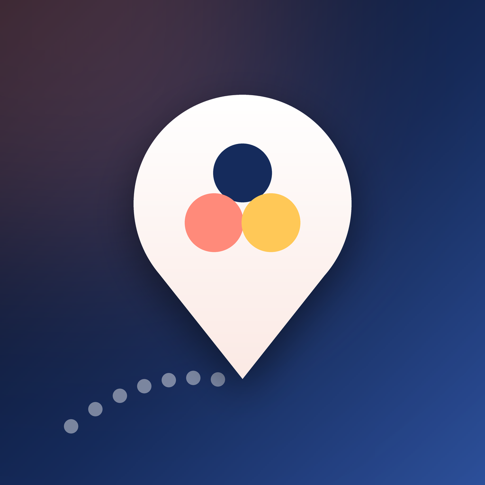
</p>

<h1 align="center">TripHub</h1>

<p align="center"><strong>Plan the trip together. Split the cost fairly. Keep everyone on the same page.</strong></p>

<p align="center">
  A group trip planner for iPhone and Android<br>
  FBLA Mobile Application Development 2026–2027 · Topic: <em>"Together We Go: Group Trip Planner"</em>
</p>

---

## The problem

Planning a trip with friends usually means a group chat nobody can scroll back through, a spreadsheet one person maintains, and a payment app for settling up afterwards. Plans get lost, money gets awkward, and someone always asks "wait, what time are we leaving?"

## Our solution

**TripHub puts the whole trip in one app.** One person creates the trip and shares a 6-character invite code. Friends join in seconds. From then on everyone sees the same itinerary, budget, checklist and announcements, and when one person makes a change, it appears on everyone else's phone right away.

### The Trip Hub (home screen)

Everything about the trip at a glance: a boarding-pass style card with the countdown, the next stop, budget and checklist progress, the latest announcement, and what is coming up. Scrolling down shows the invite code, sharing and the crew.

<p align="center">
  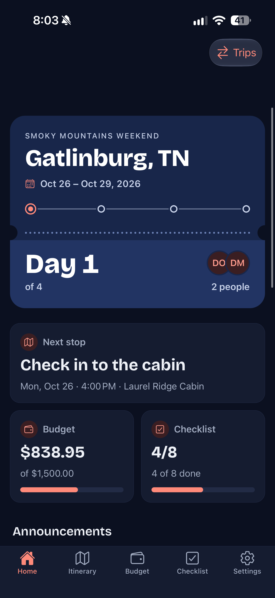
  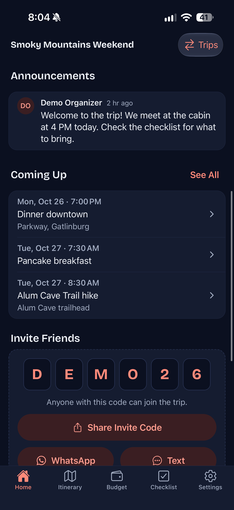
  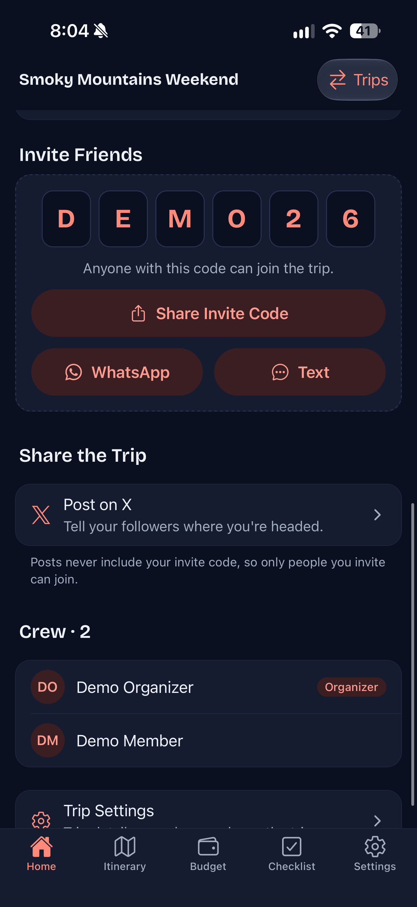
</p>

### The Itinerary

The trip day by day. Today is marked, the dotted Route line connects each day's stops, and the speech bubble on each activity shows how many comments the group has left on it. Anyone on the trip can add or edit activities.

<p align="center">
  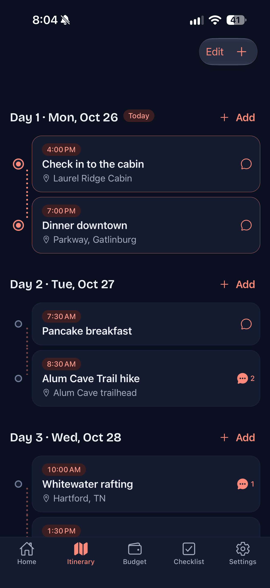
  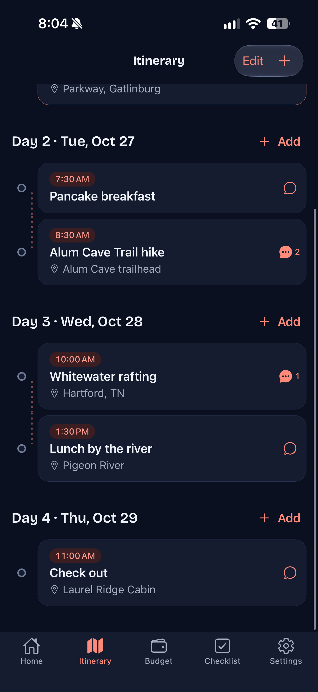
</p>

### Budget and settle-up

How much the group has spent against its budget, who owes whom (in the fewest payments possible), and every expense with who paid and how it was split. The Trip Summary at the end wraps up the money and the trip.

<p align="center">
  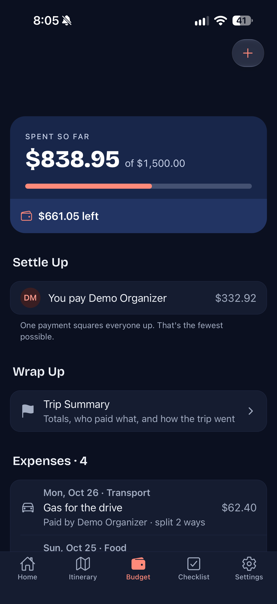
  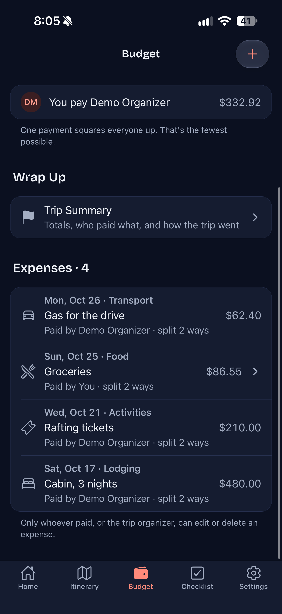
</p>

### The shared checklist

One list for the whole group, split into Packing, To-Do and Bookings. Items can be assigned to someone, and finished items show who did them. The quick-add box adds items fast, and pasting a list adds one item per line.

<p align="center">
  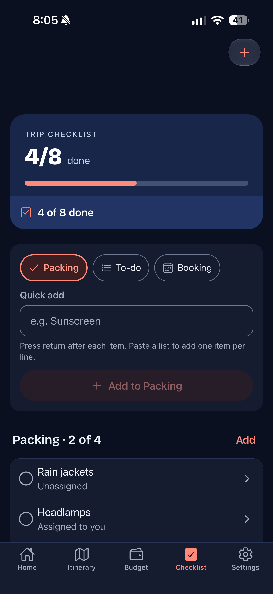
  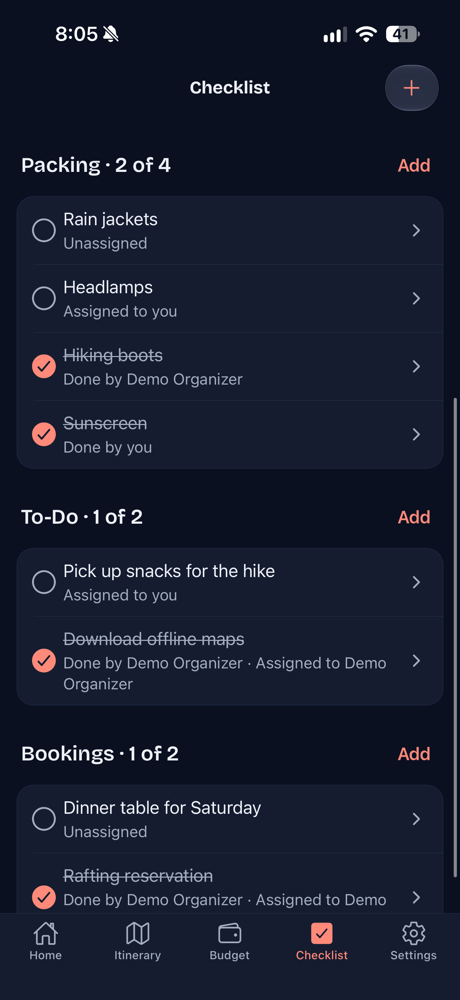
</p>

### Settings, light mode and dark mode

Settings holds your profile and name, the current trip, reminder switches, and appearance. TripHub follows the phone's light or dark setting by default, and you can pin it to Light or Dark. The same screen is shown below in both. Account controls (sign out and permanently delete your account) are at the bottom.

<p align="center">
  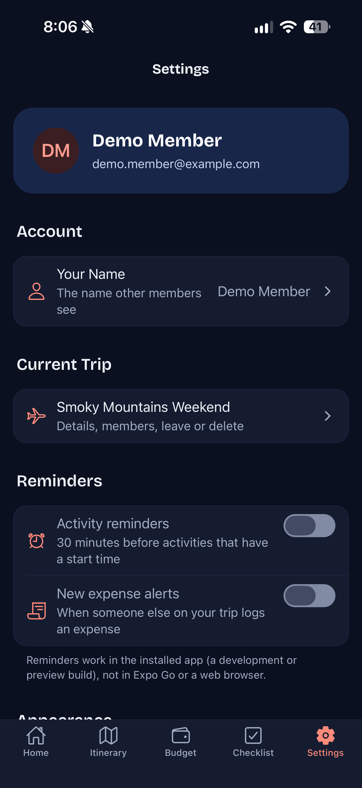
  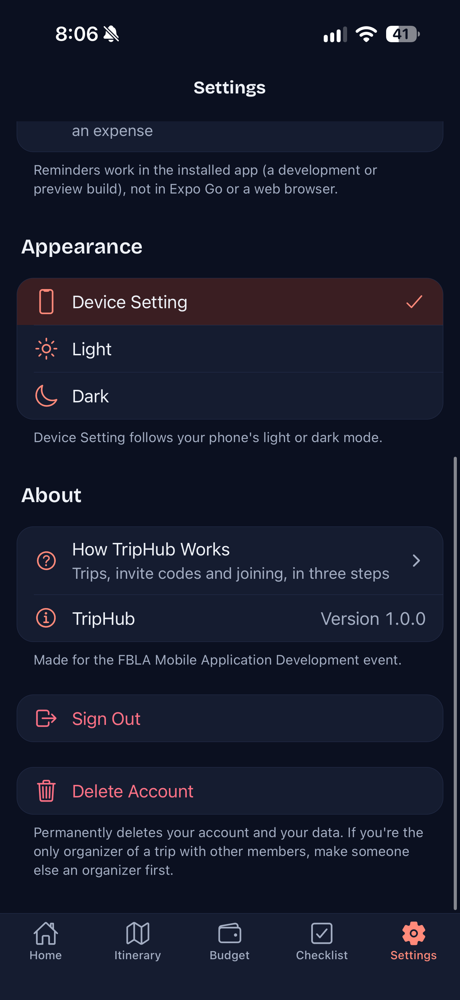
  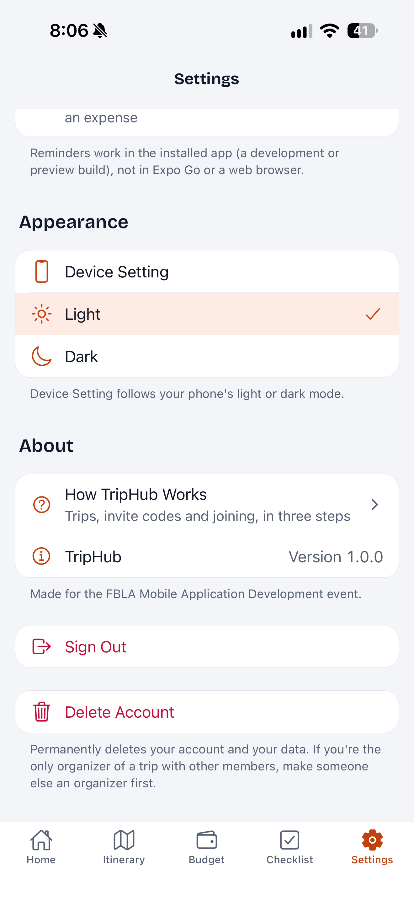
</p>

## What you can do with it

| Need | How TripHub helps |
| --- | --- |
| **Get everyone on the trip** | Create a trip and share the invite code (or a link) straight to WhatsApp or Messages. Friends join with one tap. |
| **Plan the days** | A shared day-by-day itinerary. Anyone can add, edit or reorder activities. Each activity has its own comment thread. |
| **Never miss a plan** | Reminders arrive 30 minutes before every activity that has a start time. |
| **Stay in touch** | Organizers post announcements; the latest one is shown on the home screen. |
| **Handle the money** | Log expenses and split them evenly or by shares. See what is left of the budget and who owes whom, in the fewest possible payments. Mark payments as paid until everyone is square. |
| **Stay organized** | One shared checklist for packing, to-dos and bookings, with assignees and progress. Paste a whole list to add it in one go. |
| **Manage the group** | Organizers can edit the trip, promote members, remove members, or delete the trip. Anyone can leave. |
| **Look back** | A Trip Summary shows spending versus budget, who paid what, and what got done. |

Everything updates live, works in light and dark mode, and still shows your saved trip when the connection drops.

## How it answers the FBLA topic

The 2026–2027 topic asks for an app that helps a group organize and manage a shared trip from planning through completion.

| The topic asks for | TripHub |
| --- | --- |
| Multiple users | Accounts, invite codes and links, organizer and member roles |
| Collaboration | Shared itinerary and checklist with live updates |
| Communication | Announcements and comment threads on every activity |
| Scheduling | Day-by-day itinerary, "Coming Up", activity reminders |
| Budgeting | Budget, split expenses in exact cents, minimal settle-up |
| Organization | Shared checklist with assignees and progress |
| Trip management | Trip Settings for organizers; switch between trips |
| Planning through completion | Trip progress ("Day 2 of 4"), settle-up, then the Trip Summary |
| Social media | Share invites to WhatsApp and Messages; post about the trip on X |

The detailed map from the rating sheet to screens and code is in [docs/planning/requirements-map.md](docs/planning/requirements-map.md).

## Designed for everyone

- **Familiar and clear.** Bottom tabs, large titles and native sheets that feel at home on both iPhone and Android. A navy and sunset-orange look, with a dotted "Route" line as the signature element.
- **Accessible.** Text scales with the phone's size setting, colors meet WCAG AA contrast in light and dark, every control is at least 44 × 44 points and labeled for screen readers, and nothing relies on color alone. Animations stop when Reduce Motion is on.
- **Forgiving.** Every form explains its mistakes in plain words, destructive actions ask first, and a missing connection never produces a blank or red error screen.
- **Private by design.** Database rules mean you can only see trips you belong to. Nobody outside the trip can read or change its data.

Details: [design system and UX audit](docs/design-system.md) · [user journey and accessibility](docs/user-journey-and-accessibility.md).

## Built and tested with care

| | |
| --- | --- |
| **Technology** | React Native with Expo (one TypeScript codebase for iOS and Android), Supabase (database, sign-in and live updates) |
| **Structure** | MVVM: screens only draw, view models hold state, models hold the rules, services talk to the server |
| **Money** | Stored as whole cents, so splits always add up exactly |
| **Automated checks** | 249 unit tests (money, validation, dates, links), a database test that runs every migration and checks the access rules as several different users, and a color-contrast check |
| **Planning evidence** | [Timeline](docs/planning/timeline.md) · [wireframes](docs/planning/wireframes.md) · [rating-sheet self-assessment](docs/planning/self-assessment.md) · [usability test plan](docs/planning/usability-test-plan.md) |

## Try it

1. Install the dependencies and add your Supabase settings to a `.env` file:

   ```bash
   npm install
   ```

   ```
   EXPO_PUBLIC_SUPABASE_URL=...
   EXPO_PUBLIC_SUPABASE_ANON_KEY=...
   ```

2. Start the app and scan the QR code with Expo Go (iPhone or Android):

   ```bash
   npx expo start
   ```

3. To see a fully loaded trip, load the demo trip (**Smoky Mountains Weekend**, invite code `DEMO26`). Steps are in the [technical reference](docs/technical-reference.md#demo-mode).

Reminders and invite links need an installed build instead of Expo Go; see [Building a preview](docs/technical-reference.md#building-a-preview-eas).

## Where to read more

| Document | What it covers |
| --- | --- |
| [Technical reference](docs/technical-reference.md) | Setup, builds, architecture, every database table and access rule, credits and licenses |
| [Requirements map](docs/planning/requirements-map.md) | The FBLA prompt and rating sheet, item by item, mapped to the app |
| [Design system](docs/design-system.md) | Colors, type, components and the UX audit |
| [Demo script](docs/presentation/demo-script.md) | The timed presentation run |
| [Known limits](docs/presentation/known-limits.md) | What TripHub deliberately does not do |

## Credits

TripHub's code and artwork (including the app icon) are by the TripHub team. It builds on open-source software: Expo, React Native, React Navigation, Supabase, react-hook-form, Zod and Ionicons (all MIT), and the Bricolage Grotesque typeface (SIL Open Font License). WhatsApp and X names and logos are trademarks of their owners; TripHub is not affiliated with either. No stock photos are used. The full list with versions and licenses is in the [technical reference](docs/technical-reference.md#credits-and-licenses).

Event guidelines: [FBLA Mobile Application Development](https://www.fbla.org/competitive-events/mobile-application-development/). See [LICENSE](LICENSE) for the project license.
