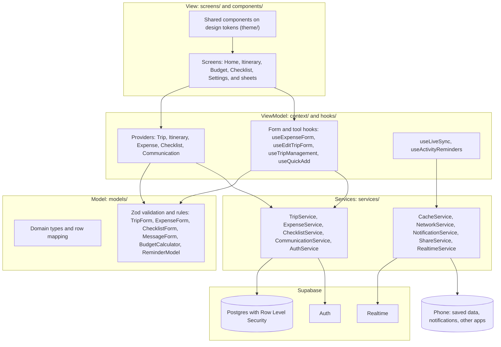

# TripHub

TripHub is a group trip planner for phones, built with Expo and React Native on a Supabase backend. A group creates or joins a trip with an invite code, plans the days together, splits what it spends, shares a packing and to-do list, and talks it through, with every phone updating live.

## FBLA Mobile Application Development

TripHub is our entry for the **FBLA Mobile Application Development** event, 2026–2027 topic **"Together We Go: Group Trip Planner"**. The topic asks for an app that helps a group organize and manage a shared trip from planning through completion, with support for collaboration, communication, scheduling, budgeting, organization and trip management for multiple users. The event guidelines and rating sheet are published by FBLA on the [Mobile Application Development event page](https://www.fbla.org/competitive-events/mobile-application-development/).

- **Platform.** iOS and Android phones (tablets work too) from one TypeScript codebase. It runs standalone as an installed build (see [Building a preview](#building-a-preview-eas)); no app store needed.
- **Planning documents.** [Timeline](docs/planning/timeline.md), [wireframes and user journey](docs/planning/wireframes.md), [requirements map](docs/planning/requirements-map.md), [rating sheet self-assessment](docs/planning/self-assessment.md), [design system and UX audit](docs/design-system.md).

### How TripHub answers the prompt

| The prompt asks for | TripHub |
| --- | --- |
| **Multiple users** | Accounts; create a trip (you're its organizer) or join one with a 6-character invite code or a `triphub://join/CODE` link. Everyone on a trip sees the same data. |
| **Collaboration** | Any member can plan the itinerary and share the checklist; changes from other phones appear live (Supabase Realtime). |
| **Communication** | Organizer announcements (latest one on Home) and a comment thread on every activity. |
| **Scheduling** | Day-by-day itinerary within the trip's dates, reorderable, with "Coming Up" on Home and reminders 30 minutes before each timed activity. |
| **Budgeting** | Trip budget, expenses split evenly or by shares in exact integer cents, what's left, and a settle-up in the fewest payments. Alerts when someone else logs an expense. |
| **Organization** | Shared checklist in Packing / To-Do / Bookings, with assignees, "done by", progress, and quick add for whole lists. |
| **Trip management** | Trip Settings: edit details, make organizers, remove members, leave, delete. Switch between trips. |
| **Planning through completion** | Trip progress on Home ("Day 2 of 4"), and settle-up to close out the money afterwards. |
| **Social media** (rating sheet) | Invites go straight to WhatsApp or Messages, and **Post on X** starts a public post; each opens the app directly, with a web fallback. |

The full map from prompt and rating sheet to screens and code is in [docs/planning/requirements-map.md](docs/planning/requirements-map.md).

### Demo steps

About 7 minutes with two phones (A = organizer, B = member). Before presenting, load the demo trip ([Demo mode](#demo-mode)), sign in on both phones, and turn on notifications on both.

1. **Why** (30 s). Group trips fall apart across group chats, spreadsheets and payment apps; TripHub keeps them in one place.
2. **Join** (1 min). On A, Home → Invite Friends → **WhatsApp** or **Text** shows the invite with the link and code. On B, Join with Code (or open the link) to show the code filled in.
3. **Plan together** (1.5 min). On A, add an activity with a start time; it appears on B without refreshing. On B, open its comment bubble and ask a question; A sees it. Mention the reminder 30 minutes before.
4. **Money** (1.5 min). On B, log an expense split by shares; A gets an alert and the budget and settle-up change. Point out integer cents and validation (try $0 or a blank name).
5. **Organize** (1 min). On A, paste a packing list into Checklist quick add; tick one on B and watch it tick on A ("Done by …").
6. **Manage** (30 s). Trip Settings: Make Organizer, Remove from Trip, the confirmation, and why the last organizer can't leave.
7. **Reliability and access** (30 s). Airplane mode on A: saved data, offline banner, edits refused politely; back online, it catches up. Dark mode and large text.
8. **Under the hood** (30 s). MVVM layers below, Row Level Security, 230+ unit tests and `npm run test:db`.

Judges may not scan QR codes or click links, so show invites on the phones themselves.

## Getting started

```bash
npm install
npx expo start
```

Create a `.env` file in the project root (it is git-ignored) with your Supabase project's values:

```
EXPO_PUBLIC_SUPABASE_URL=...
EXPO_PUBLIC_SUPABASE_ANON_KEY=...
```

Restart the dev server after changing it. Checks to run before committing:

```bash
npx tsc --noEmit   # types
npx expo lint .    # lint (the bare `expo lint` only checks components/)
npm test           # unit tests (Jest): models, validation, links, dates
npm run test:db    # database rules: runs every migration in an in-memory Postgres and checks RLS as several users
npm run check:contrast  # WCAG contrast of the color tokens
```

### Setting up Supabase

1. In the SQL editor, run `supabase/schema.sql` (the baseline), then every file in `supabase/migrations/` **in numeric order**. All of them are safe to re-run.
2. Authentication → Sign In / Providers → **Email**: keep it enabled and turn **"Confirm email" off**. The app doesn't use email confirmation; new accounts are signed in immediately. With it on, sign-up can't complete. Anonymous sign-ins are not used.
3. Nothing else is needed: Row Level Security is switched on by the migrations (see below).

The anon key in `.env` is public by design (it ships inside the app). Row Level Security is what protects the data, which is why every table has it on.

### Building a preview (EAS)

`eas.json` defines three build profiles. None of them has been run yet; builds happen in Expo's cloud under your Expo account.

| Profile | What you get | Use it for |
| --- | --- | --- |
| `preview` | An installable Android `.apk`, and an iOS build for registered devices (internal distribution) | Judges' and teammates' phones, two-phone testing, reminders and invite links (none of which work in Expo Go) |
| `preview-simulator` | The same, but an iOS Simulator build | Demoing on a Mac without an Apple Developer account |
| `production` | Store builds (Android `.aab`, App Store iOS) with the build number bumped automatically | Publishing |

**Environment variables.** Your `.env` is git-ignored, so EAS never uploads it. Builds read the two variables from EAS instead, from the environment named in each profile (`preview` or `production`). Set them once per environment, using the same values as your `.env`. They're `plaintext` because `EXPO_PUBLIC_` values are compiled into the app anyway (the anon key is public by design; Row Level Security protects the data):

```bash
npx eas-cli@latest env:set preview --name EXPO_PUBLIC_SUPABASE_URL --value "https://YOUR-PROJECT.supabase.co" --visibility plaintext
```

```bash
npx eas-cli@latest env:set preview --name EXPO_PUBLIC_SUPABASE_ANON_KEY --value "YOUR-ANON-KEY" --visibility plaintext
```

Repeat with `production` for store builds. `npx eas-cli@latest env:list preview` shows what's set. A build made without them opens on a "TripHub isn't set up yet" screen rather than crashing.

**First build.** Link the project to your Expo account once (this adds `extra.eas.projectId` to `app.json`), then build:

```bash
npx eas-cli@latest init
```

```bash
npx eas-cli@latest build --profile preview --platform android
```

The first build asks for an Android package name and iOS bundle identifier (for example `com.yourteam.triphub`) and saves them in `app.json`. iOS device builds also need an Apple Developer account; `preview-simulator` doesn't.

### Demo mode

`supabase/seed/demo_trip.sql` preloads a trip to present: **Smoky Mountains Weekend** (invite code `DEMO26`), starting today, with 7 activities (one later today, so a reminder can fire during the demo), 4 expenses ($838.95 of a $1,500 budget, split evenly), 8 checklist items with some done, an announcement, and comment threads.

1. Run `schema.sql` and migrations 001–009 on a **demo or test** Supabase project (not one with real users' data).
2. In the app, create `demo.organizer@example.com` with Create Account. Optionally also create `demo.member@example.com` and `demo.friend@example.com` (for the second and third phones). Any passwords work.
3. Paste `supabase/seed/demo_trip.sql` into the SQL editor and run it. It says how many members it added.
4. Sign in as the organizer (and the member on a second phone) and pull down to refresh, or relaunch.

Run it again any time to reset the demo: it deletes the old `DEMO26` trip and rebuilds it around today's date. `npm run test:db` checks the seed too.

### When the server can't be reached

- **No connection, or Supabase down or unreachable.** Everything already loaded stays on screen from the phone's saved copy, with a banner, and changes say up front that they need a connection. Requests give up after 15 seconds instead of spinning (`utils/fetchWithTimeout.ts`), and data reloads by itself when the connection returns. Signing in shows "Couldn't reach the server."
- **Built without the Supabase settings.** A "TripHub isn't set up yet" screen instead of a crash.
- **Anything unexpected while drawing a screen.** A "Something went wrong" screen with Try Again (`components/ErrorBoundary.tsx`), never a blank or red screen.

## Architecture (MVVM)

TripHub follows Model–View–ViewModel. Screens only draw and forward taps; view models (React context providers and hooks) hold state and turn taps into changes; models are plain TypeScript with the rules, testable without React or a network; services are the only code that talks to Supabase or the device.



A change flows one way: a screen calls a view-model function (for example `addExpense`), which validates with a model, saves through a service, and updates state; the screen redraws. Changes from other phones arrive through `RealtimeService` and are merged by the same view models.

### How the code is organized

| Folder | What lives there |
| --- | --- |
| `models/` | Plain data types, row mapping, and rules. Validation lives here as zod schemas (`TripForm`, `ItineraryForm`, `ExpenseForm`, `ChecklistForm`, `MessageForm`, `AuthForm`); the money math (splits, budget summary, settle-up) is `BudgetCalculator`. No React, no network. Unit tests sit next to them in `models/__tests__/`. |
| `services/` | Everything that talks to Supabase or the device: `TripService`, `ExpenseService`, `ChecklistService`, `CommunicationService`, `AuthService`, `CacheService`, `NetworkService`, `ShareService` (system share sheet, WhatsApp, Messages and X links), `NotificationService` (local reminders and alerts), `RealtimeService` (live updates). They throw typed errors with user-safe messages. |
| `context/`, `hooks/` | App state (auth, trips, itinerary, expenses, checklist, messages, network, theme) and the form hooks that tie react-hook-form to the models and services. |
| `theme/` | Design tokens (`theme.ts`): colors for light and dark, type roles, spacing, radii, motion. Read through `useTheme()`. |
| `screens/`, `components/` | Presentation only. Navigation is React Navigation (`App.tsx` → `screens/RootNavigator.tsx`). Screens are built from the shared components; none defines its own button, row, or field styles. |
| `scripts/` | `check-contrast.js` (WCAG check of the color tokens) and `make-icons.py` (builds the app icon, Android icon layers, splash, and favicon from `assets/TripHub Icon.jpg`). |
| `supabase/` | `schema.sql` (baseline) and `migrations/` (everything since). |

Forms use react-hook-form, with the rules themselves written in zod under `models/` so they can be tested without React.

## Itinerary

The Itinerary tab is the trip day by day, from the start date to the end date, hung on the Route (the dotted line from the app icon). Today is marked, and the Route is drawn lighter for days still ahead.

- **Plan together.** Any member can add an activity (title, day, optional time, place and notes), edit it, or reorder a day with **Edit** and the arrows. Screen-reader users get Move earlier / Move later on every activity at any time. Only whoever added an activity, or an organizer, can delete it.
- **Talk about it.** The bubble on each activity shows how many comments it has and opens its thread (see Announcements and comments).
- **Validation.** Syntactic: a title (up to 100 characters), a real date, a time like 9:30 pm, and length limits on place and notes. Semantic: the day must fall within the trip's dates (also enforced by a database trigger), and trip dates can't later be shortened around a planned activity.
- **Reminders** go off 30 minutes before activities with a start time (see Reminders).

## Budget and settle-up

The Budget tab shows what the active trip has spent against its budget (with how much is left, or how far over it is), who owes whom, and every expense.

- **Expenses.** Description, amount, category, who paid, and how it's split: **evenly** among the people you pick, or **by shares** (a couple takes 2). Each person's amount previews as you type, and the sheet warns before an expense takes the trip over budget.
- **Exact money.** Amounts are integer cents. A split always adds up to exactly the expense; leftover cents go to the largest remainders, ties in roster order (`BudgetCalculator.splitByShare`).
- **Settle-up in the fewest payments.** Each person's balance is what they paid minus what they owe. People can always settle in one fewer payment than there are people with a balance, and every group within them whose balances cancel out saves one more. `BudgetCalculator.settleUp` searches for the largest number of such groups exactly (fine for groups up to 15 people; larger groups fall back to pairing the largest debtor with the largest creditor), then settles each group. The tests include a case where the simple pairing needs 4 payments and TripHub needs 3.
- **Who can change what.** You log what you paid; an organizer can log an expense for anyone. Only whoever paid, or an organizer, can edit or delete it. The app hides editing from everyone else, and the database enforces the same rule (see `expenses` below).
- **Validation.** Syntactic: description required and under 80 characters, an amount like `42.50`, whole-number shares from 0 to 99. Semantic: more than $0 and at most $1,000,000, the payer and everyone in the split are on the trip, and at least one person shares the cost. The database checks the split again with a trigger.

## Checklist

The Checklist tab is one shared list per trip, in three groups: **Packing**, **To-Do** and **Bookings**. A header card shows progress ("5 of 12 done"), and each group shows its own count.

- **Everyone sees the same list.** Items live in the database, so any member can add an item, tick it off, rename it, move it to another group, assign it to a member, or reopen it. Pull down to refresh; it also reloads when the connection returns. Open items sit above finished ones.
- **Who did it.** A finished item says "Done by Alex". The database records who ticked it and when (from the caller's own id, in a trigger), so nobody can tick an item on someone else's behalf.
- **Who can delete.** The member who added an item, or a trip organizer, like the itinerary. The app only offers Delete to them.
- **Ticking is instant.** The check appears straight away and is put back, with a message, if it can't be saved.
- **Quick add.** The box under the progress card adds items fast: pick Packing, To-Do or Bookings once, then type an item and press return, again and again (the keyboard stays up). Pasting a list adds one item per line, with bullets, numbers and checkboxes stripped and repeats skipped, up to 25 at a time. If one can't be saved, what wasn't added stays in the box.
- **Validation.** Syntactic: a name is required and at most 100 characters, and the group is one of the three. Semantic: the assignee must be a member of the trip (an item assigned to someone who later leaves shows as assigned to "a former member" and can still be ticked or reassigned). The database checks the same rules with constraints and a trigger.

## First run

A three-step intro (`screens/WelcomeScreen.tsx`) opens the first time the app is launched on a phone, before signing in: plan the trip together, invite with a code, and how friends join (typing the code or opening the link). **Skip** or **Get Started** goes to sign-in, and it isn't shown again on that phone. **Settings → How TripHub Works** replays it.

## Organizer tools

**Trip Settings** (from the bottom of Home, or Settings → Current Trip) shows the trip's details and members.

- **Edit the trip** (organizers). Name, destination, dates and budget, with the same rules as creating a trip, plus two more: a trip that has already started keeps its start date (only a *new* start date can't be in the past), and the dates must still cover every planned activity. The database checks the second rule too.
- **Manage members** (organizers). Tap someone to **Make Organizer** or **Remove from Trip**. Screen-reader users get both as actions on the row.
- **Leave the trip** (anyone). Every trip keeps at least one organizer, so the last organizer is told to make someone else organizer first, or delete the trip.
- **Delete the trip** (organizers). Removes it for everyone, along with its itinerary, expenses, checklist and messages.
- **Confirmation and safety.** Every one of these asks first and says what will happen. They need a connection (and say so offline). Leaving or deleting also clears that trip's saved data from the phone. Expenses logged by someone who leaves stay in the budget, shown as "Former member".

## Announcements and comments

Two lightweight ways for the group to talk, both stored per trip in the database.

- **Announcements.** Organizers post updates for everyone (meeting times, changes, reminders). Home shows the latest one; **Announcements** lists them all, newest first, with the composer at the bottom for organizers. Members read them.
- **Comments on activities.** Every itinerary activity has a comment thread. The bubble button on each activity on the Itinerary shows how many comments it has and opens the thread; any member can comment.
- **Who can delete.** An announcement: any organizer. A comment: whoever wrote it, or an organizer. Nothing is ever edited: post a correction instead. The app only shows Delete to people allowed to use it, and the database enforces the same rules (see `trip_announcements` and `activity_comments` below).
- **Validation.** Syntactic: some text, at most 500 characters (line endings tidied and runs of blank lines collapsed first). Semantic: only an organizer can post an announcement, and a comment's activity must still exist. The database checks the length again and works out a comment's trip from its activity, so a comment can't be attached to a trip you aren't on.
- **Offline.** Messages are saved on the phone with everything else and readable offline; posting needs a connection and says so up front.

## Sharing and invite links

- **Invite by link.** Every invite carries a link, `triphub://join/CODE`, along with the code itself. Opening the link opens TripHub's **Join Trip** sheet with the code filled in; the person still taps **Join Trip** to join. If nobody is signed in yet, the sign-in screen says there's an invite waiting and the Join sheet opens right after signing in or creating an account. A link for a trip you're already on offers **Open Trip** instead. Malformed links are ignored (`utils/inviteLink.ts`).
- **Straight to the app.** Home's Invite Friends card has **Share Invite Code** (the system share sheet) plus **WhatsApp** and **Text** buttons that open those apps with the invite ready to send. **Post on X** under *Share the Trip* starts a public post about the trip; it never includes the invite code, so strangers can't join from it.
- **When the app isn't there.** TripHub tries the app first and then a web link that opens the app or its website (`wa.me`, `twitter.com/intent/tweet`), so a missing WhatsApp or X never dead-ends. A device that can't send texts (an iPad, a simulator) gets a message pointing to the share sheet instead. No URL schemes need declaring, because the app never asks `canOpenURL`.
- **Trying a link while developing.** `triphub://` links need a development or preview build (the scheme is set in `app.json`). In Expo Go, use the Expo form of the link instead, replacing the address with the one `npx expo start` prints:

  ```bash
  npx uri-scheme open "exp://192.168.1.5:8081/--/join/K7M9PQ" --android
  ```

  With a build installed, `npx uri-scheme open "triphub://join/K7M9PQ" --ios` (or `--android`) opens it directly.

## Design system & accessibility

The full design plan, UX audit, user journey, and rationale are in [docs/design-system.md](docs/design-system.md). In short:

- **Look and feel.** Familiar iOS patterns that also work on Android: a bottom tab bar with icons, native large-title headers on iOS (a standard top bar on Android), grouped lists, native sheets for forms and the trip switcher, and system confirmations (action sheets on iOS, dialogs on Android) for destructive actions. Midnight & Sunset palette: navy carries the identity (icon, trip hero card) and sunset orange is used only for things you can tap, selection, and the Route.
- **Signature element: the Route.** A dotted sunset-orange line with round stops. It links each day's activities on the Itinerary, shows trip progress on Home, and appears as the trail of dots leading to the pin in the app icon, splash screen, and empty states.
- **Tokens.** Everything visual comes from `theme/theme.ts`. Colors follow the system light or dark setting by default; Settings → Appearance can pin the app to Light or Dark instead. When the system asks for more contrast (Increase Contrast on iOS, High contrast text on Android), secondary text and separators get stronger.
- **Icons.** Ionicons from `@expo/vector-icons`, through `components/Icon.tsx`. No Apple logos, trademarks, or SF Symbols artwork. The app icon is the team's own artwork (`assets/TripHub Icon.jpg`); rebuild every icon size from it with `python scripts/make-icons.py`.

Accessibility commitments, checked before each release:

| Area | What the app does |
| --- | --- |
| Text size | All text uses the token type styles and scales with the system setting. Rows, headers, and segmented controls stack vertically at accessibility sizes (`useLargeText`). Icons grow with the text. Only bar labels (tab bar, header buttons) are capped, at 1.4–1.5x, because the system fixes their height. |
| Contrast | Every text pair meets WCAG AA (4.5:1) and every control outline 3:1, in light and dark. Run `npm run check:contrast` after changing a color. |
| Touch targets | Every interactive element is at least 44 x 44 pt. |
| Screen readers | Every control has `accessibilityRole` and a label; icon-only buttons are labeled; decorative graphics are hidden; headings are marked; field errors are announced and repeated when you return to the field; itinerary rows offer "Move earlier / Move later" actions. |
| Color alone | Errors, offline, today, and the current trip always have an icon, a badge, or words as well as color. |
| Motion | Only the Route fill-in on Home and the loading-skeleton pulse animate. Both stop when Reduce Motion is on. |

## Live updates

The itinerary, expenses, checklist, announcements and comments of the open trip update by themselves when someone else changes them, using Supabase Realtime (`hooks/useLiveSync.ts`, `services/RealtimeService.ts`). Nobody has to pull to refresh.

- **Only your trips.** Each list listens to its own trip only, and Supabase checks the same read policies before sending a row, so no one receives another trip's data. Deleted rows arrive as just an id, and the app removes an id only if it's showing it.
- **Your own changes** are shown as soon as the server confirms them; when their echo arrives it just replaces the same row. A checklist tick still being saved isn't overwritten by an older echo.
- **Falling back.** Offline, the app stops listening and shows what's saved (see below). When the connection comes back, every list reloads and live updates resume. A reload also runs when live updates recover after an outage and when the app comes back to the foreground, since a phone pauses connections in the background. If Realtime can't be used at all (switched off for the project, or `009_live_sync.sql` not run), the app behaves exactly as before: pull to refresh, and reload on reconnect.
- **Setup.** Running `009_live_sync.sql` adds the five tables to the `supabase_realtime` publication. Nothing else is needed.

## Reminders

Local notifications, scheduled by the phone itself (`services/NotificationService.ts`, rules in `models/ReminderModel.ts`):

- **Activity reminders.** 30 minutes before every activity on the open trip that has a start time. They're rescheduled automatically when an activity is added, retimed, renamed, moved or deleted, including by someone else (live updates), and cleared when you leave or delete the trip, sign out, or turn them off. At most 20 per trip are kept scheduled (iOS allows 64 pending notifications per app).
- **New-expense alerts.** When someone else on the trip logs an expense while TripHub is open or running: "Sam paid $42.50 for Dinner." Your own expenses never alert you.
- **Settings → Reminders** has a switch for each. Both start on, but nothing appears until the phone grants permission: TripHub asks the first time you save an activity with a start time (or turn a switch on, or tap **Allow Notifications**). If notifications are off for TripHub in the phone's settings, the screen says so and links there.
- **Where they work.** In development, preview and store builds. Expo Go (SDK 53 and later) and the web don't support them, so there the switches are disabled with an explanation. Reminders for a trip are refreshed whenever that trip is open. Alerts while the app is fully closed would need server push notifications, which TripHub doesn't use.

## Offline behavior

Trips (and which one is open) and each trip's itinerary, expenses, checklist, announcements and comments are saved on the device per user and shown immediately at launch, then replaced with fresh data. The budget summary and settle-up are worked out on the phone, so they're readable offline too. A banner shows while the device has no connection, and data reloads when it returns. Edits made offline are rejected with a clear message rather than queued (expense, checklist and message changes say so straight away, without waiting for the request to fail). Signing out erases the saved data.

## Database schema

All ids are `uuid`. Dates are `date`; money is stored as integer cents.

### `profiles`
One row per user, created automatically by a trigger when they sign up. Holds the name other trip members see.

| Column | Notes |
| --- | --- |
| `id` | Primary key, references `auth.users`; deleted with the user |
| `display_name` | 1–50 characters, optional |
| `created_at` | |

### `trips`

| Column | Notes |
| --- | --- |
| `id` | Primary key |
| `name` | 3–50 characters |
| `destination` | The trip's location |
| `start_date`, `end_date` | `end_date` may not be before `start_date` |
| `budget_cents` | `>= 0`; 0 means no budget set |
| `invite_code` | Unique; exactly 6 uppercase letters/digits. How people join. |
| `created_at` | |

### `trip_members`
Who is on which trip. Primary key `(trip_id, user_id)`.

| Column | Notes |
| --- | --- |
| `trip_id` | References `trips`; rows are deleted with the trip |
| `user_id` | References `profiles`; rows are deleted with the user |
| `role` | `organizer` or `member` |

### `itinerary_items`
One activity on one day of a trip.

| Column | Notes |
| --- | --- |
| `id` | Primary key |
| `trip_id` | References `trips`; deleted with the trip |
| `day` | Must fall within the trip's dates (enforced by a trigger) |
| `title` | 1–100 characters |
| `time` | Optional start time |
| `location` | Optional, up to 120 characters |
| `notes` | Optional, up to 1000 characters |
| `sort_order` | Position within the day, 1 = first |
| `created_by` | Defaults to the signed-in user; references `auth.users` |
| `created_at` | |

### `expenses`
One thing the group paid for. Tightened in `005_expenses.sql`.

| Column | Notes |
| --- | --- |
| `id` | Primary key |
| `trip_id` | References `trips`; deleted with the trip |
| `paid_by` | References `profiles`; must be a member of the trip (trigger) |
| `description` | 1–80 characters |
| `amount_cents` | More than 0, at most 100,000,000 ($1,000,000) |
| `category` | `lodging`, `food`, `transport`, `activities`, `shopping` or `other` |
| `splits` | JSON object: member user id → cents they owe. Whole, non-negative cents, only trip members, adding up to exactly `amount_cents` (trigger) |
| `shares` | JSON object of weights 0–99 when split by shares; `NULL` when split evenly |
| `created_at` | |

### `checklist_items`
One item on a trip's shared checklist. Added in `006_checklist.sql`.

| Column | Notes |
| --- | --- |
| `id` | Primary key |
| `trip_id` | References `trips`; deleted with the trip |
| `title` | 1–100 characters |
| `category` | `packing`, `todo` or `booking` |
| `assigned_to` | Optional; references `profiles`. Must be a member of the trip when set or changed (trigger); cleared if that account is deleted |
| `done` | Whether it has been ticked off |
| `completed_by`, `completed_at` | Who ticked it and when. Set by the trigger from the caller's id; the app cannot write them |
| `created_by` | Defaults to the signed-in user; references `auth.users` |
| `created_at` | |

### `trip_announcements`
An update an organizer posted to the whole trip. Added in `007_communication.sql`.

| Column | Notes |
| --- | --- |
| `id` | Primary key |
| `trip_id` | References `trips`; deleted with the trip |
| `body` | 1–500 characters |
| `created_by` | Defaults to the signed-in user (the app can't set it); references `auth.users` |
| `created_at` | Set by the database |

### `activity_comments`
A comment on an itinerary activity. Added in `007_communication.sql`.

| Column | Notes |
| --- | --- |
| `id` | Primary key |
| `item_id` | References `itinerary_items`; deleted with the activity |
| `trip_id` | Copied from the activity by a trigger (the app can't set it), so policies can filter by trip |
| `body` | 1–500 characters |
| `created_by` | Defaults to the signed-in user (the app can't set it); references `auth.users` |
| `created_at` | Set by the database |

### Functions

| Function | What it does |
| --- | --- |
| `create_trip(...)` | Creates a trip and records the caller as its organizer in one transaction. Raises `unique_violation` if the invite code is taken (the app retries with a new code). |
| `join_trip_by_code(code)` | Finds the trip by invite code and adds the caller as a `member`. Raises `invite_not_found` or `already_member`. |
| `reorder_itinerary_items(trip, day, ids[])` | Saves one day's order atomically. Runs as the caller, so the itinerary policies still apply. |
| `check_expense_splits()` | Trigger on `expenses`: the payer and everyone in the split are on the trip, and the split adds up to the amount. Raises `payer_not_member`, `split_member_not_on_trip`, `splits_total_mismatch` or `invalid_splits`. |
| `check_checklist_item()` | Trigger on `checklist_items`: an assignee must be on the trip (checked when set or changed), and `completed_by` / `completed_at` follow `done` and the caller. Raises `assignee_not_member`. |
| `make_trip_organizer(trip, user)` | Organizers only: makes another member an organizer. Raises `not_permitted` or `member_not_found`. |
| `keep_an_organizer()` | Trigger on `trip_members`: refuses to remove a trip's last organizer (`last_organizer`), except when the whole trip or the person's account is being deleted. |
| `check_trip_dates_cover_itinerary()` | Trigger on `trips`: new dates must still include every activity's day (`activities_outside_dates`). |
| `set_activity_comment_trip()` | Trigger on `activity_comments`: fills in the comment's trip from its activity. Raises `activity_not_found` if the activity is gone or not on one of your trips. |
| `is_trip_member(trip)`, `is_trip_organizer(trip)`, `shares_trip_with(user)` | Helpers used by the policies. They are `SECURITY DEFINER` because a policy that queries `trip_members` directly would recurse forever. |

Signed-out visitors cannot call any of these.

## Row Level Security

Rule of thumb: **you can only see and change trips you are a member of; only an organizer can edit or delete a trip; any member can plan the itinerary, share the checklist and comment on activities; only organizers post announcements; only whoever paid, or an organizer, can change an expense.** RLS is enabled on every table, and the `anon` role (not signed in) has no access to any of them.

Policies are defined, with comments, in `supabase/migrations/004_access_control.sql`, and for later features in `005_expenses.sql` (expenses), `006_checklist.sql` (checklist), `007_communication.sql` (announcements and comments) and `008_organizer_tools.sql` (organizer rules). `npm run test:db` checks them.

### `profiles`

| Operation | Who | Policy |
| --- | --- | --- |
| Read | You, and anyone who shares a trip with you | Read own profile and profiles of people on your trips |
| Update | You, `display_name` only | Update own profile |
| Insert | Nobody directly | Created by the signup trigger |

### `trips`

| Operation | Who | Policy |
| --- | --- | --- |
| Read | Members | Members can read their trips |
| Update | Organizers; only name, destination, dates and budget (never `invite_code`) | Organizers can edit their trips |
| Delete | Organizers | Organizers can delete their trips |
| Insert | Nobody directly | Use `create_trip()` |

### `trip_members`

| Operation | Who | Policy |
| --- | --- | --- |
| Read | Members see the whole roster of their trips | Members can see who is on their trips |
| Delete | You (leave a trip) or an organizer (remove someone), but never the trip's last organizer (trigger, `008_organizer_tools.sql`) | Leave a trip, or organizers remove members |
| Insert / update | Nobody directly | Use `create_trip()`, `join_trip_by_code()` and `make_trip_organizer()` |

### `itinerary_items`

| Operation | Who | Policy |
| --- | --- | --- |
| Read | Members | Members can read their trip's itinerary |
| Insert | Members, as themselves (`created_by` must be you) | Members can add itinerary items as themselves |
| Update | Any member; only `day`, `title`, `time`, `location`, `notes`, `sort_order` (an item can't be moved to another trip or re-attributed) | Members can edit and reorder itinerary items |
| Delete | The member who added it, or an organizer | Authors and organizers can delete itinerary items |

### `expenses`

| Operation | Who | Policy |
| --- | --- | --- |
| Read | Members | Members can read their trip's expenses |
| Insert | Members, for an expense they paid; organizers, for anyone | Members log what they paid; organizers log for anyone |
| Update | Whoever paid, or an organizer; only `paid_by`, `description`, `amount_cents`, `category`, `splits`, `shares` (an expense can't move to another trip). A member can't hand an expense to someone else. | Payers and organizers can edit expenses |
| Delete | Whoever paid, or an organizer | Payers and organizers can delete expenses |

### `checklist_items`

| Operation | Who | Policy |
| --- | --- | --- |
| Read | Members | Members can read their trip's checklist |
| Insert | Members, as themselves (`created_by` must be you) | Members can add checklist items as themselves |
| Update | Any member; only `title`, `category`, `assigned_to`, `done` (an item can't move to another trip, and the completion stamp is the database's) | Members can edit checklist items |
| Delete | The member who added it, or an organizer | Authors and organizers can delete checklist items |

### `trip_announcements`

| Operation | Who | Policy |
| --- | --- | --- |
| Read | Members | Members can read their trip's announcements |
| Insert | Organizers, as themselves; only `trip_id` and `body` can be sent | Organizers can post announcements as themselves |
| Update | Nobody | — |
| Delete | Organizers | Organizers can delete announcements |

### `activity_comments`

| Operation | Who | Policy |
| --- | --- | --- |
| Read | Members | Members can read their trip's comments |
| Insert | Members, as themselves; only `item_id` and `body` can be sent | Members can comment as themselves |
| Update | Nobody | — |
| Delete | Whoever wrote it, or an organizer | Authors and organizers can delete comments |

### Why invites go through a function

A person who isn't on a trip yet can't read it, so the app can't look up a trip by invite code with a normal query. `join_trip_by_code()` does the lookup with elevated rights and adds the member itself. The same reasoning applies to `create_trip()`: with no direct insert on `trips` or `trip_members`, the trip and its organizer row have to be written together.

Invite codes are 6 characters from a 31-character alphabet (about 887 million combinations) and there is currently no rate limiting on join attempts. Lengthen the code (`INVITE_CODE_LENGTH` in `utils/inviteCode.ts`, plus the check in `002_trip_constraints.sql`) if that matters for your use.

### Changing a policy

Add a new numbered migration rather than editing an old one, and keep the explanatory comment next to each policy. After changing access rules, add checks to `scripts/test-database.mjs` and run `npm run test:db`, then re-test in the app with at least two accounts: one on the trip, one outside it.

## Credits and licenses

TripHub's own code and artwork are by the TripHub team. Everything else it uses is listed here.

### Libraries the app ships with

| Package | Version | License |
| --- | --- | --- |
| [Expo](https://expo.dev) (`expo`, `expo-crypto`, `expo-font`, `expo-notifications`, `expo-splash-screen`, `expo-status-bar`, `@expo/metro-runtime`) | SDK 57 | MIT |
| [React](https://react.dev) and React DOM | 19.2 | MIT |
| [React Native](https://reactnative.dev) | 0.86 | MIT |
| [React Native Web](https://github.com/necolas/react-native-web) | 0.21 | MIT |
| [React Navigation](https://reactnavigation.org) (`native`, `native-stack`, `bottom-tabs`, `elements`) | 7 | MIT |
| [react-native-screens](https://github.com/software-mansion/react-native-screens) | 4.26 | MIT |
| [react-native-safe-area-context](https://github.com/AppAndFlow/react-native-safe-area-context) | 5.7 | MIT |
| [@react-native-async-storage/async-storage](https://github.com/react-native-async-storage/async-storage) | 2.2 | MIT |
| [@react-native-community/datetimepicker](https://github.com/react-native-community/datetimepicker) | 9.1 | MIT |
| [@react-native-community/netinfo](https://github.com/react-native-netinfo/react-native-netinfo) | 12.0 | MIT |
| [@supabase/supabase-js](https://github.com/supabase/supabase-js) | 2.116 | MIT |
| [react-hook-form](https://react-hook-form.com) | 7.90 | MIT |
| [Zod](https://zod.dev) | 4.6 | MIT |
| [@expo/vector-icons](https://github.com/expo/vector-icons) | 15.1 | MIT |

### Tools used to build and test it (not shipped in the app)

| Package | License |
| --- | --- |
| [TypeScript](https://www.typescriptlang.org) | Apache-2.0 |
| [ESLint](https://eslint.org) and `eslint-config-expo` | MIT |
| [Jest](https://jestjs.io) and `jest-expo` | MIT |
| `@types/jest`, `@types/react` ([DefinitelyTyped](https://github.com/DefinitelyTyped/DefinitelyTyped)) | MIT |
| [PGlite](https://pglite.dev) (`@electric-sql/pglite`, in-memory Postgres for `npm run test:db`) | Apache-2.0 |
| [Pillow](https://python-pillow.org) and [NumPy](https://numpy.org) (Python, used by `scripts/make-icons.py`) | MIT-CMU; BSD-3-Clause |

Licenses are as declared by each package (`npm ls` and each package's `package.json`). The libraries those packages depend on are listed in `package-lock.json`.

### Icons, artwork and fonts

- **App icon, splash and in-app mark.** The team's own "Pin & Orbit" artwork (`assets/TripHub Icon.jpg`); every icon size is generated from it by `scripts/make-icons.py`.
- **Interface icons.** [Ionicons](https://ionic.io/ionicons) by Ionic, MIT license, through `@expo/vector-icons`.
- **WhatsApp and X logos.** The Ionicons `logo-whatsapp` and `logo-x` glyphs label the share buttons only. WhatsApp is a trademark of WhatsApp LLC and X is a trademark of X Corp.; TripHub isn't affiliated with or endorsed by either.
- **Fonts.** The phone's system fonts; none are bundled.
- **Backend.** [Supabase](https://supabase.com) (hosted Postgres, Auth and Realtime).

### Sources

- FBLA, *Mobile Application Development* 2026–2027 guidelines and rating sheet ([event page](https://www.fbla.org/competitive-events/mobile-application-development/)). Referenced, not reproduced.
- Apple [Human Interface Guidelines](https://developer.apple.com/design/human-interface-guidelines/) and Google [Material Design](https://m3.material.io) for platform conventions, and W3C [WCAG 2.2](https://www.w3.org/TR/WCAG22/) for contrast and accessibility (see [docs/design-system.md](docs/design-system.md)).
- [Expo](https://docs.expo.dev), [React Navigation](https://reactnavigation.org/docs/getting-started) and [Supabase](https://supabase.com/docs) documentation for the APIs used.

## Before submitting

- **Remove the vendored design-review skill.** `.claude/skills/apple-design/` (and `skills-lock.json`) is a third-party Claude Code skill containing summaries of Apple's Human Interface Guidelines. It was a development aid for the design review, isn't part of the app, and its content isn't ours to redistribute. Delete it from the copy of the repository you submit, or check its license first. It is flagged here and left in place for now.
- **LICENSE.** Make sure `LICENSE` names the team, not the Expo template.
- **Secrets.** `.env` is git-ignored; only the public anon key is ever compiled into the app.
