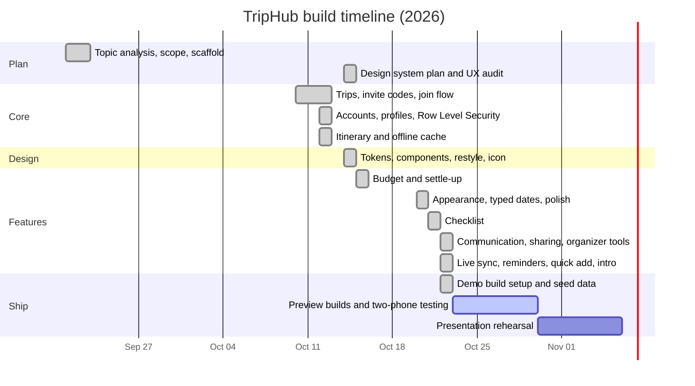

# Project timeline

How TripHub was planned and built, in the order the work happened. Dates come from the project's commit history, so they show when each piece actually landed. We worked in short **iterations**: each one picked the next most valuable slice of the prompt, built it end to end (database migration → model and validation → service → view model → screens → tests → docs), and reviewed it before starting the next.

## Milestones

| Date | Milestone | What it delivered |
| --- | --- | --- |
| Sep 21–22 | **Kickoff** | Read the topic, chose Expo + React Native + Supabase, set up the MVVM folders (models, services, context, screens). |
| Oct 10–12 | **Core loop** | Create a trip, get an invite code, join with it. Email accounts and profiles. Row Level Security on every table. Day-by-day itinerary with reorder. Offline cache. WCAG contrast fixes. First README with schema and policies. |
| Oct 14 | **Design system** | UX audit and design plan (`docs/design-system.md`), typed design tokens, shared component library, native headers and sheets, the team's Pin & Orbit icon and splash, light and dark palettes. |
| Oct 15 | **Budget** | Expenses with even or by-shares splits in integer cents, budget summary, settle-up in the fewest payments, with unit tests. |
| Oct 20 | **Usability pass** | Light/dark/device appearance setting, typed dates and times, live password match, Cancel on forms. |
| Oct 21 | **Checklist** | Shared packing, to-do and booking items with assignees, "done by" and progress. |
| Oct 22 | **Group features** | Announcements and activity comments; sharing to WhatsApp, Messages and X; `triphub://join/CODE` links; organizer tools; live sync; reminders; quick add; first-run intro; database rule tests (`npm run test:db`). |
| Oct 22 | **Demo readiness** | EAS preview build profiles, demo-trip seed, graceful failure when the server is unreachable, credits and licenses, these planning documents. |
| Next | **Device testing** | Install preview builds on two phones; run the two-phone test list; fix what it finds. |
| Next | **Rehearsal** | Practice the 7-minute demo (README → Demo steps) and the 3-minute Q&A; time each section; prepare an offline backup (screen recording) in case venue internet fails. |

## How we decided what to build next

1. **Prompt coverage first.** Each topic area (collaboration, communication, scheduling, budgeting, organization, trip management) needed at least one complete feature before any got a second. See [requirements-map.md](requirements-map.md).
2. **Rating sheet second.** Items worth points that a feature alone doesn't earn (input validation on two levels, data security, social media, accessibility, documentation) were built into every feature rather than added at the end.
3. **Risk third.** Things that only show up on real devices (notifications, invite links, live updates between phones) were built early enough to test on two phones before the competition.

## Definition of done (every feature)

- Database rules in a new numbered migration, with Row Level Security, checked by `npm run test:db`.
- Validation in a zod model with syntactic and semantic rules, covered by unit tests.
- Works offline for reading, and says so clearly when a change needs a connection.
- Accessible: labels for screen readers, 44 pt targets, large-text layouts, color never the only signal.
- Built on the design tokens and shared components.
- Typecheck, lint and tests pass; README updated.
