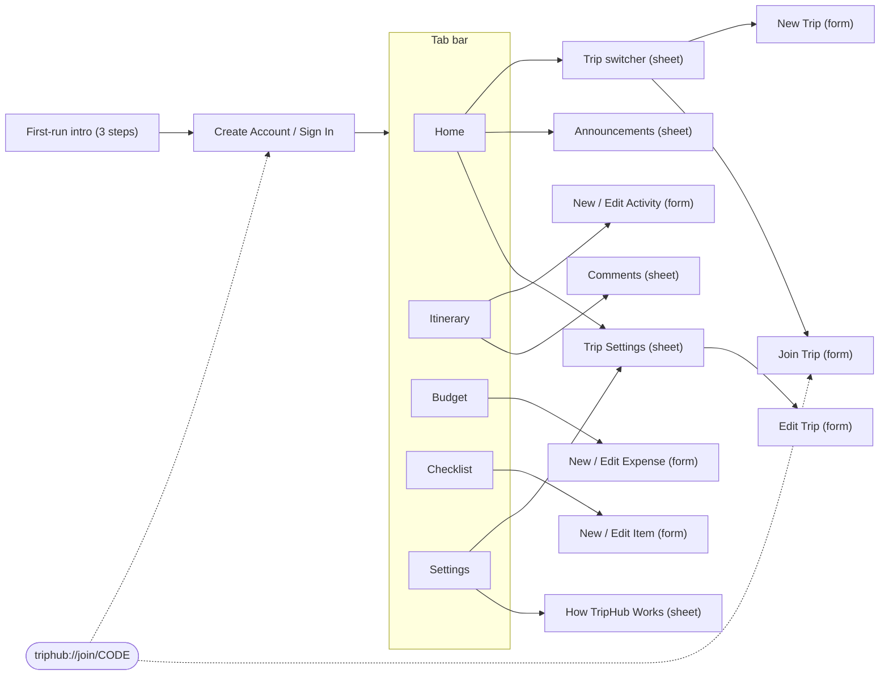
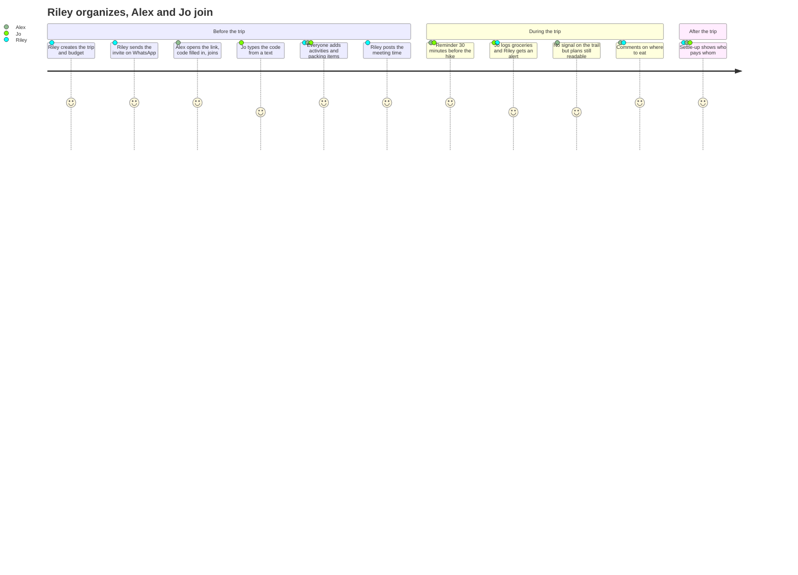

# Wireframes and user journey

Low-fidelity layouts of TripHub's main screens, the navigation between them, and the journey of a typical group. The finished screens follow these layouts; colors, type and spacing come from the design tokens in [`docs/design-system.md`](../design-system.md).

## Navigation map



Forms open as full-height sheets with Cancel (iOS) or back (Android) and ask before discarding changes. Destructive actions always confirm with an action sheet (iOS) or dialog (Android).

## Screens

### Home

```
┌──────────────────────────────────┐
│ Smoky Mountains Weekend   ⇄ Trips│  ← large title = trip name
├──────────────────────────────────┤
│ ╭──────────────────────────────╮ │
│ │ 📍 Gatlinburg, TN            │ │  ← navy hero card
│ │ Oct 22 – Oct 25, 2026        │ │
│ │ ●┄┄●┄┄○┄┄○   Day 1 of 4      │ │  ← the Route: trip progress
│ │ (AB)(RK)(JS)  3 people       │ │
│ ╰──────────────────────────────╯ │
│ Announcements              Post  │
│ ┌──────────────────────────────┐ │
│ │ (RK) Riley · 2 hr ago        │ │
│ │ We meet at the cabin at 4 PM │ │
│ └──────────────────────────────┘ │
│ Coming Up                 See All│
│ │ Today · 4:00 PM               ›│
│ │ Check in to the cabin         ││
│ Invite Friends                   │
│ │        K 7 M 9 P Q            ││
│ │ [   Share Invite Code   ]     ││
│ │ [WhatsApp]   [Text]           ││
│ Budget                           │
│ │ 💳 Spent of budget  $839/$1500›│
│ Share the Trip                   │
│ │ X  Post on X                  ›│
│ Crew · 3                         │
│ Trip Settings                   ›│
├──────────────────────────────────┤
│  Home  Itinerary Budget List  ⚙  │
└──────────────────────────────────┘
```

### Itinerary

```
┌──────────────────────────────────┐
│ Itinerary                Edit  + │
├──────────────────────────────────┤
│ Day 1 · Thu, Oct 22  [Today] +Add│
│ ●  ┌───────────────────────┬───┐ │
│ ┆  │ 4:00 PM               │💬2│ │  ← tap card: edit
│ ┆  │ Check in to the cabin │   │ │    tap bubble: comments
│ ┆  └───────────────────────┴───┘ │
│ ●  ┌───────────────────────┬───┐ │
│    │ 7:00 PM  Dinner       │💬 │ │
│    └───────────────────────┴───┘ │
│ Day 2 · Fri, Oct 23        + Add │
│ ○  …                             │
└──────────────────────────────────┘
In Edit mode the bubble is replaced by ↑ ↓ reorder buttons.
```

### Comments (sheet)

```
┌──────────────────────────────────┐
│ Comments                    Done │
├──────────────────────────────────┤
│ ┌ Fri, Oct 23 · 8:30 AM ────────┐│
│ │ Alum Cave Trail hike          ││
│ │ 📍 Alum Cave trailhead        ││
│ └───────────────────────────────┘│
│ 2 Comments                       │
│ (AK) Alex · 3 hr ago          🗑 │
│      Should we pack lunch?       │
│ (RK) You · 2 hr ago           🗑 │
│      Pack lunch, great spot…     │
├──────────────────────────────────┤
│ Add a comment                    │
│ [ Ask a question or share a tip ]│
│ [        ➤ Post Comment        ] │  ← stays above the keyboard
└──────────────────────────────────┘
```

### Budget

```
┌──────────────────────────────────┐
│ Budget                         + │
├──────────────────────────────────┤
│ $838.95 of $1,500                │
│ ███████████░░░░░░░  $661 left    │
│ Settle Up                        │
│ │ Alex pays Riley      $120.50  ││
│ │ Jo pays Riley         $43.25  ││
│ Expenses                         │
│ │ 🚗 Gas for the drive  $62.40  ││
│ │ 🍴 Groceries          $86.55  ││
└──────────────────────────────────┘
```

### Checklist

```
┌──────────────────────────────────┐
│ Checklist                      + │
├──────────────────────────────────┤
│ 5 of 8 done  ██████████░░░░░     │
│ ┌──────────────────────────────┐ │
│ │ (✓Packing) (To-do) (Booking) │ │  ← quick add
│ │ [ e.g. Sunscreen           ] │ │    return adds, keyboard stays
│ │ [   + Add to Packing       ] │ │
│ └──────────────────────────────┘ │
│ Packing · 2 of 4                 │
│ │ ○ Rain jackets                ›│
│ │   Unassigned                  ││
│ │ ✓ ~~Hiking boots~~            ›│
│ │   Done by Riley               ││
└──────────────────────────────────┘
```

### Trip Settings (sheet)

```
┌──────────────────────────────────┐
│ Trip Settings               Done │
├──────────────────────────────────┤
│ Trip                        Edit │
│ │ Name        Smoky Mountains … ││
│ │ Dates       Oct 22 – Oct 25   ││
│ │ Budget      $1,500.00         ││
│ Members · 3                      │
│ │ (RK) Riley (you)   [Organizer]││
│ │ (AK) Alex                    ›││  ← Make Organizer / Remove
│ Tap someone to make them an      │
│ organizer or remove them.        │
│ │ ⎋ Leave Trip                  ││  ← red, confirms first
│ │ 🗑 Delete Trip                 ││
└──────────────────────────────────┘
```

### First-run intro

```
┌──────────────────────────────────┐
│ (mark)                      Skip │
│ ▬ • •                            │  ← "Step 1 of 3"
│ [🗺]                              │
│ Plan the trip together           │
│ Create a trip and you're its     │
│ organizer…                       │
│                                  │
├──────────────────────────────────┤
│ [             Next             ] │
└──────────────────────────────────┘
Steps 2–3 add a sample invite code card (K7M9PQ) and the join link.
```

## User journey: a weekend trip with three friends



**Pain points this design addresses:** plans scattered across chats (one shared itinerary and checklist), "who paid for what?" (exact splits and settle-up), people who didn't see the update (announcements, live sync, reminders), and no signal on the road (offline reading).
